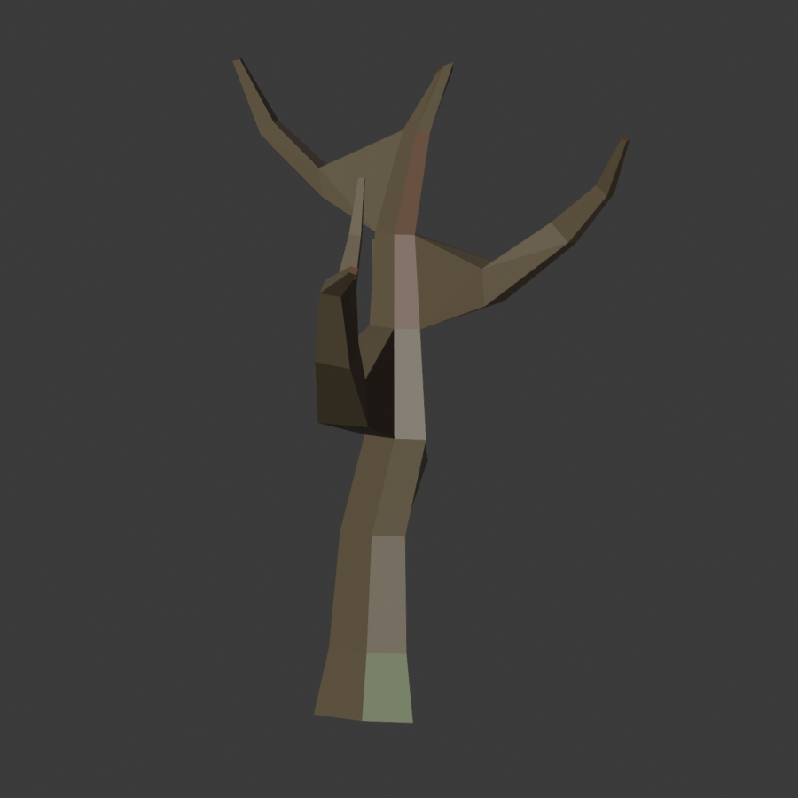

# Marshward Dead Tree

## Brief

Settled crossing views from `(0,2500,360)` and `(0,4300,360)` at pitch -3,
yaw 163 and -161 respectively, show a break between the two west peat banks
in front of the rocky ridge. Add a single leafless, asymmetric snag in that
break. Its silhouette should read as a distant marsh tree, not an arch,
gate, route cue or climbable obstacle. Do not add exposed roots, foliage,
tussocks, new lighting or new materials.

Build `SM_MarshwardDeadTree_01` in an isolated Blender scene. Target a
720 x 500 x 800 cm envelope, a base-center pivot at Z=0 and a flat trunk
foot. Use one connected closed trunk and branch mesh, a leaning broken
crown, a few tapering forks, one UV channel and no authored collision.
Keep the lower trunk and branches in the existing marsh earth palette;
use existing timber for exposed wood and moss for parts of the foot.
Retain source, export, measured metrics and a preview.

Propose one NoCollision `Marshward_DeadTreeWest` at `(-2850,3350,-120)`,
yaw 0, unit scale. The whole crown must fit within X=-3210..-2490,
Y=3100..3600, outside the full-width route buffers and existing dressing.
Keep all 48 preceding static actor properties, route supports, PlayerStart,
markings and basin-only wet peat. Verify exact first-hit basin support
beneath the trunk with no ignored actors. Review settled approaches from
both crossing directions and the arrival vista before accepting placement.
Do not treat stills or collision rays as physical camera proof.

## Source

The isolated Blender build joins four tapering limbs and two smaller forks
to the trunk through open faces rather than overlapping separate parts.
The mesh is one closed 260-triangle component with one UV channel and no
hulls. A non-adjacent triangle overlap check rejected two early fork joins.
The corrected forks extend away from their parent faces and passed before
export. The final classic FBX retained exact dimensions and reused the
three existing earth, timber and moss materials. The timber path exception
remains scoped to the timber slot of the three specific meshes that reuse it.

The base-center pivot is under the center of the visible box. The offset
trunk foot is recorded separately in `dead_tree_metrics.json`, so the
live footing probe samples the wood's actual center, not the pivot.

## Placement And Evidence

The initialized editor saved only the proposed tree, with all preceding 48
actor signatures unchanged. A digest guards all preceding 26 dressing
rows. The map now has 49 static placements, 16 installed imported mesh types,
and 17 validated mesh packages including the retained greybox marker.
The crown is at least 2,165 cm from the protected crossing edge. The saved
asset's measured bounds also clear all prior dressing and the full-width
corridors plus 75 cm.

- All 54 focused host tests passed, including an intrusion control in which
  a clear trunk does not excuse an overhanging crown. Fresh classic FBX
  and the independent saved-map check passed with real exit zero, exact
  markers and no Python errors. Ownership and settings of the basin-only
  wet-peat material stayed unchanged.
- The separate Fenwatch 31-package aggregate and all 16 initialized-world
  suites passed. The settled Causeway live suite passed 579 support and
  1,104 clearance rays plus all existing controls. One new unfiltered
  ray first-hit the saved BasinCatch at Z=-120 under the trunk foot. This
  tests the ground at that point, not underside contact across the foot.
- The two west-facing crossing stills put the forks against the sky.
  Arrival at X=0 and X=+/-500, Y=-450, Z=260, pitch -5/yaw 90, retained
  the pale deck and far pillars/lintel. The near marker screens part of
  the tree in the center still, without hiding the marker's carved face.
- Normal floating PIE reached the Human Warrior HUD (level 1, HP 100/100,
  mana 50/50) through synthetic Slate, and stopped. Native discovery listed
  133 tests; no full native rerun or C++ build was needed.

Causeway was left All Saved outside PIE with no dirty packages. Its file
SHA256 is `d89cb2275d0745750c362ac6d81bc79d99b53e62426380c32b1fe4f33d0a0517`.
Fenwatch, the protected save, the keeper material and all reused materials
were unchanged. Physical walking, first-visit wayfinding and moving-camera
acceptance remain open.

Logs: `/tmp/embermere-nov19-dead-tree-import.log`,
`/tmp/embermere-nov19-fenwatch-31-packages.log`,
`/tmp/embermere-nov19-causeway-packages.log`,
`/tmp/embermere-nov19-dead-tree-placement-editor.log` and
`/tmp/embermere-nov19-dead-tree-final-editor.log`.
