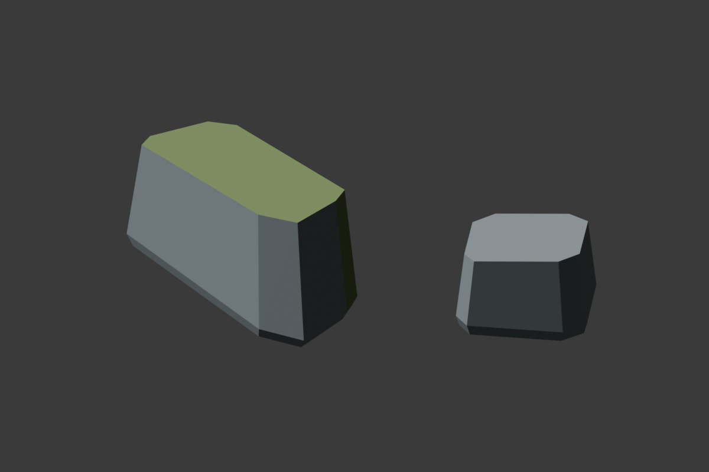

# Marshward Fallen Masonry

## Ownership And Brief

Fresh viewport-only ruin views from (0,6100,360), pitch-8/yaw140, and
(-350,6200,380), pitch-10/yaw145, show the west shoulder between the
marker and foundation course. Add one small scatter of broken worked stone,
not another straight foundation row or marker. This is presentation-only
ruin dressing, with no interaction, reward, cover-system or traversal owner.

`SM_MarshwardFallenMasonry_01` is 500 x 300 x 140 cm, base-center pivot,
two separate closed fractured-beam volumes with unequal sloping tops and
flat bases at Z=0. Target 88 triangles, one UV channel, zero non-manifold
edges and exactly two authored convex hulls, one per fragment. Reuse only
`M_MarshwardMarshStone` and `M_MarshwardMoss`, without editing either.
Keep independent Blender scene/source, FBX, preview and deterministic metrics.

Place only `Marshward_FallenMasonryWest` at (-1130,6700,120), yaw0, unit
scale, BlockAll, using the existing marsh tag/folder. Its visible bounds
X=-1380..-880,Y=6550..6850 lie wholly on RuinIsland, outside full-width
corridors plus 75 cm. Keep at least 80 cm from the marker's bounds, 140 cm
from the foundation and 290 cm from the pillar. No previous actor moves,
changes mesh, material, transform or collision profile. The map becomes
44 static placements/ten meshes, retaining all prior 43 actors and original
22 greybox placements. PlayerStart, support geometry, buffers, arrival guard,
basin-only wet peat and lighting remain unchanged. No water, hazards, enemies,
quests, services, travel, save schema, startup-map or C++ changes.

## Gates

Inspect the Blender preview and measure topology, UVs, dimensions and hulls.
Require fresh classic-FBX import, exact reused material/collision checks and
a separate fresh saved-map gate. Check all installed dressing AABBs against
every original full-width corridor+75 cm. Preserve all existing live route,
arrival, bank, rock, apron and foundation controls. Add two positive fragment
hits at their authored center heights and two adjacent island supports at
Z120, without ignoring actors; these prove nearby footing, not hidden
underside contact. Inspect west-shoulder, arrival and ramp views and run clean
PIE. Physical two-direction walking, moving-camera clearance and first-visit
wayfinding remain separate user gates; no playtest state was supplied.

## Verification: 2026-11-10

Blender MCP produced the briefed 500 x 300 x 140 cm, 88-triangle mesh,
one UV, zero non-manifold edges and two authored hulls. Source preview was
inspected; neither reused material nor any existing source was edited.
Fresh classic-FBX import passed its exact metric/hull/material marker,
true exit zero, no Python errors. Twenty-four focused host checks passed:
16 corridor, five foundation and three new masonry checks. An initial
counterfactual endpoint missed the tested segment; the fixture now tests
an actual horizontal-access intrusion, without changing clearance rules.

The initialized placement helper reused the numeric preservation signature,
verified every prior actor unchanged and saved only the new scatter. Fresh
saved-map validation passed **ten meshes / 44 static placements**, full-width
corridors plus 75 cm and unchanged basin-only wet peat, true exit zero,
no Python errors. Fenwatch's independent skeletal-material-first 31-package
gate also passed exact Prowler, 53 Fab/32 original-art and validators=31
markers; its map and protected user hashes remained exact.

The clean final session passed all **16 Fenwatch suites**, **579 support /
1104 clearance** Causeway rays, marker, six banks, twelve stone/twelve
underlying-ground controls, nine basin/two apron joins, six foundation/six
adjacent-footing and nine landmark/three arrival-ground controls, plus the
new **two fragment/two adjacent island support** rays. No new ray ignores
actors. Adjacent supports do not claim hidden underside contact.

Settled west-shoulder (-350,6200,380), pitch-10/yaw145; arrival
(0,-450,260), pitch-5/yaw90; and east-ramp (1100,6400,360), pitch-8/yaw0
views were inspected at roll0/FOV90. One earlier camera-jump frame omitted
existing geometry; setting the actual viewport and recapturing restored it
without content changes. The incomplete frame was rejected. Normal 1280x754
floating PIE used the picker and reached Human Warrior HP100/100/Mana50/50
through Unreal-owned Slate, then stopped cleanly. This is not physical
input, painted player-camera or walking acceptance.

Causeway is All Saved outside PIE on real MCP8123, dirty [], no Python
errors in the final session. Fresh discovery lists 133 tests, not a new
native run; November 9's 133/133 run remains authoritative. No C++ build
was needed. Accepted Causeway SHA256:
`b3ef2ca7fccfce69422b2e06938c04dabe6ac623ed5d350130ca6c42cf28a0af`.

Logs: `/tmp/embermere-nov10-masonry-import.log`,
`/tmp/embermere-nov10-fenwatch-31-packages.log`,
`/tmp/embermere-nov10-causeway-packages.log`,
`/tmp/embermere-nov10-masonry-placement-editor.log`, and
`/tmp/embermere-nov10-masonry-final-editor.log`.
