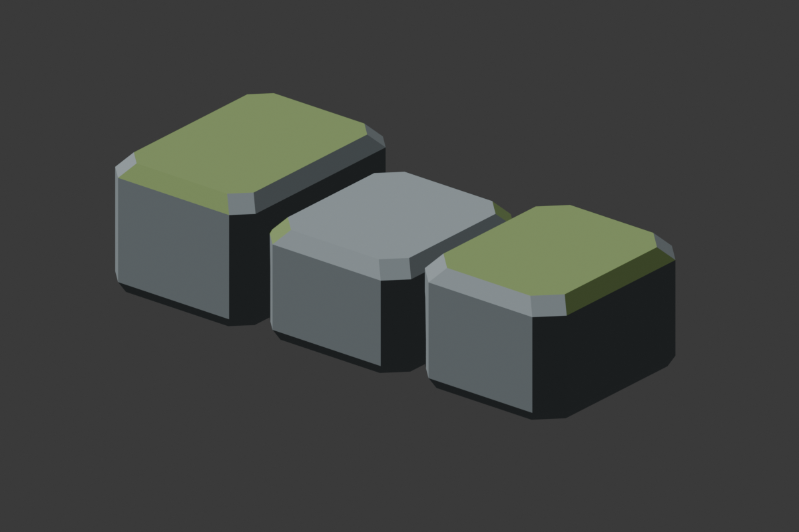

# Marshward Foundation Stones

## Ownership And Brief

Fresh viewport-only views from (0,6100,360), pitch -5/yaw90, and
(1850,5850,750), pitch -18/yaw130, show the plain northern ruin shoulder
behind the existing pillars. Add one original low foundation-course asset,
used twice on that shoulder. This supplies a small worked-stone language,
not another destination, route, wall, marker or gameplay owner.

`SM_MarshwardFoundation_01` is 600 x 260 x 150 cm with a base-center pivot.
Three separate closed, chamfered blocks have flat bases at local Z=0,
narrow open joints and unequal heights. Use one UV channel, at most 200
triangles, zero non-manifold edges and three authored convex hulls, one
per block. Reuse only `M_MarshwardMarshStone` and `M_MarshwardMoss` without
editing either material. Keep independent Blender source, FBX, metrics and
preview beside the accepted marsh kit.

Proposed placement, not yet saved: `Marshward_FoundationWest` at (-1020,7120,120) and
`Marshward_FoundationEast` at (1020,7120,120), yaw0, unit scale, BlockAll.
Use the existing marsh tag/folder. Bounds lie at X=-1320..-720 and
720..1320, Y=6990..7250: wholly on the original ruin island, beyond the
route's northern protected edge at Y=6875. The stones do not replace or
support the pillars. No other actor moves or changes mesh/material/profile.
The original island retains walking support; full-width corridors plus
75 cm, PlayerStart, arrival landmark rays and basin-only wet peat stay fixed.

After separately verified adoption, the map would become 43 static placements/nine meshes, retaining all preceding
41 actors and original 22 greybox placements. No C++, lighting, material,
water, boundary, combat, quest, service, travel or save change is authorized.
Fenwatch and protected user files remain untouched.

## Gates

Require Blender topology/dimension/UV/hull metrics and preview inspection;
fresh classic-FBX import with exact reused materials and three hulls;
saved-package checks for all assets and exact placements; and host full-width
bounds tests. In a settled initialized world, keep all route/arrival controls
and positively hit all six blocks. Six adjacent base-height rays, just beyond
each block's northern toe, must first hit the original ruin island at Z=120
without ignoring any actor. These prove nearby footing, not hidden contact
under the collider; flat source bases and exact placement retain that role.
Inspect ruin/arrival/return views and clean normal PIE. Geometric controls
and static editor views do not prove physical traversal or camera feel.

## Source Evidence: 2026-11-09

Blender MCP built the briefed 600 x 260 x 150 cm course at 180 triangles,
one UV channel, zero non-manifold edges and three authored hulls. The preview
was inspected. Both existing materials were reused without changes. Source,
FBX, metrics, preview and a separate proposed-placement manifest are retained;
the installed dressing manifest and all accepted package/live contracts stay
unchanged at 41 static placements/eight meshes.

Fresh classic-FBX import passed exact dimension/triangle/UV/hull/material
checks and exited zero without Python errors. Its local Unreal package is
not included in this source checkpoint: fresh persisted-package verification
and successful placement are still required. Sixteen existing host corridor
checks plus three new source/proposed-bounds checks passed. All 133 native
tests passed without failures/warnings/skips; Fenwatch's independent fresh
31-package gate and all 16 initialized-world suites also passed.

The first unsaved placement attempt was rejected by a faulty preservation
fixture: stringifying an Unreal Transform includes a temporary struct address.
It rolled back its two actors without saving. A following trace submission
was also rejected because those actors were absent; neither run is acceptance.
The saved Causeway map retained its exact pre-work hash. Future placement
must compare numeric transform/material/profile values, not struct reprs.

The editor close then stalled on a save-changes prompt; MCP requests stopped
responding. The user was asked to choose Don't Save for that rolled-back map.
No desktop-control substitute or process kill was used. Full Causeway package/
live adoption, clean PIE, final clean editor state and physical camera review
remain pending. Do not infer that the foundation stones are present in the map.

Evidence: `/tmp/embermere-nov09-foundation-import.log`,
`/tmp/embermere-nov09-fenwatch-31-packages.log`,
`/tmp/embermere-nov09-native-editor.log`, and the explicitly rejected
`/tmp/embermere-nov09-rejected-placement-editor.log`.
