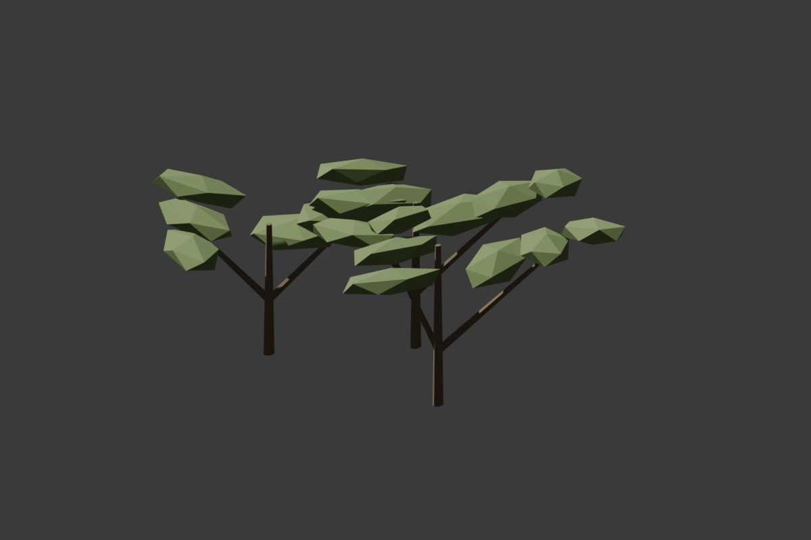

# Marshward Low Scrub

## Ownership And Brief

The settled viewport-only east-shoulder view from (2700,2700,260),
pitch -10/yaw0/roll0/FOV90, shows a low flat basin gap beside the shelf
and apron, between the two eastern reed roles. Add only one low branching
scrub silhouette, not a repeated field or new route cue. No voluntary
physical walking/camera feedback was supplied.

Build `SM_MarshwardLowScrub_01` in an independent Blender scene/source:
240 x 180 x 95 cm, base-center pivot, three grounded branching stems and
18 broad closed leaves, at most 600 triangles (accepted source:540), one UV channel, zero
non-manifold edges and zero authored collision. Reuse only the accepted
`M_MarshwardReedGreen` and `M_MarshwardEarth`, without editing either.
Retain source, FBX, metrics and preview. This is presentation-only foliage,
with no support, interaction, inventory, quest, service or save authority.

Place only `Marshward_ScrubEast` at (3550,2450,-120), yaw0, unit scale,
NoCollision, in the existing marsh-art tag/folder. Visible bounds
X3430..3670/Y2360..2540 exclude the protected return edge at X3375 and
remain separate from the apron beginning at X3730/Y2600. The original
basin retains all support. Preserve all preceding 44 static placements,
their numeric transforms/profiles/materials/mesh paths, original22,
PlayerStart, full-width corridors plus75 cm, basin-only wet peat, markers,
ruins, lighting and every earlier live guard. Result:45 static placements,
twelve imported kit meshes. No C++, water, hazards, travel or gameplay change.

## Gates

Inspect topology, dimensions, base samples, UVs, preview and absence of hulls
in Blender. Require fresh classic-FBX import and an independent fresh saved
map gate with exact reused materials, NoCollision policy and actual rotated
visible bounds. Compare stable numeric signatures twice before placement,
then verify every preceding actor before saving only the map.

Add three unfiltered stem-base-to-basin probes at Z-120 while retaining all
existing route/arrival/terrain/ruin/reed controls. These rays prove original
ground and collision policy, not visual occlusion. Inspect the shoulder and
three arrival poses with settled actual cameras, then normal picker/PIE.
Physical two-direction walking, south-turn wayfinding, moving-camera room
and painted foliage readability remain user gates, not implied by rays.

## Verification: 2026-11-12

Blender MCP produced the independent 240 x 180 x 95 cm,540-triangle
source with three stems/18 broad leaves,one UV,zero non-manifold edges and
no hulls. Its preview was inspected. Both reused materials and every
existing source remain unchanged. Thirty focused host tests passed:16
corridor,five foundation,three masonry,three tall-reed and three scrub.
The new counterfactual test rejects visible corridor intrusion even though
the scrub has no collision; no buffer or support tolerance was relaxed.

Fresh classic-FBX import passed exact geometry/material/zero-hull checks,
true exit zero/no Python errors. The sandbox startup exited before the
authoring run; the identical command with host permissions is the accepted
result. Initialized placement compared stable signatures twice before
spawning, preserved all preceding44 static actors and saved only one new
NoCollision actor. Fresh independent saved-map validation passed twelve
kit meshes/original22 plus23 dressing,full buffers and unchanged basin-only
wet peat,true exit zero/no Python/material errors. Fenwatch's separate
skeletal-material-first31-package gate passed exact skeletal,Prowler loot,
53 Fab/32 original-art and validators=31 markers,true exit zero/no Python errors.

The clean final session passed all16 Fenwatch suites,complete Causeway579
support/1104 clearance and every earlier marker,bank,rock,apron,foundation,
masonry,arrival and tall-reed control. Three new unfiltered stem-base rays
first-hit the original basin at Z-120; the scrub remains NoCollision.
These checks certify original ground,not foliage visual occlusion.

The settled briefed shoulder view shows the low clump separate from the
pale route and bank apron. Three arrival views at X0,-500,+500,Y-450,Z260,
pitch-5/yaw90/roll0/FOV90 retained the crossing and pillar/lintel silhouette.
The actual editor camera was settled before each explicit-pose viewport
capture. Normal1280x754 floating PIE confirmed Human Warrior Level1,
XP0/100,HP100/100,Mana50/50 through Unreal-owned Slate and stopped. No
physical input, painted player-camera or complete walk is claimed.

Fresh discovery lists133 native tests,not another full run; November9's
133/133 zero-failure/warning/skip run remains authoritative. No C++ build
was needed. Causeway is All Saved outside PIE on real MCP8123,dirty[],with
no Python errors in the final session. Fenwatch and protected save/keeper
hashes stayed exact. Causeway SHA256:
`0ab9d967d7910c829900d1d4b6124dc6ae3d9712b6838809846639ae6e4e4717`.

Logs: `/tmp/embermere-nov12-low-scrub-import.log`,
`/tmp/embermere-nov12-fenwatch-31-packages.log`,
`/tmp/embermere-nov12-causeway-packages.log`,
`/tmp/embermere-nov12-low-scrub-placement-editor.log`, and
`/tmp/embermere-nov12-low-scrub-final-editor.log` (exact success markers,
`LOW_SCRUB_FINAL_DIRTY []`,correct Causeway world).
