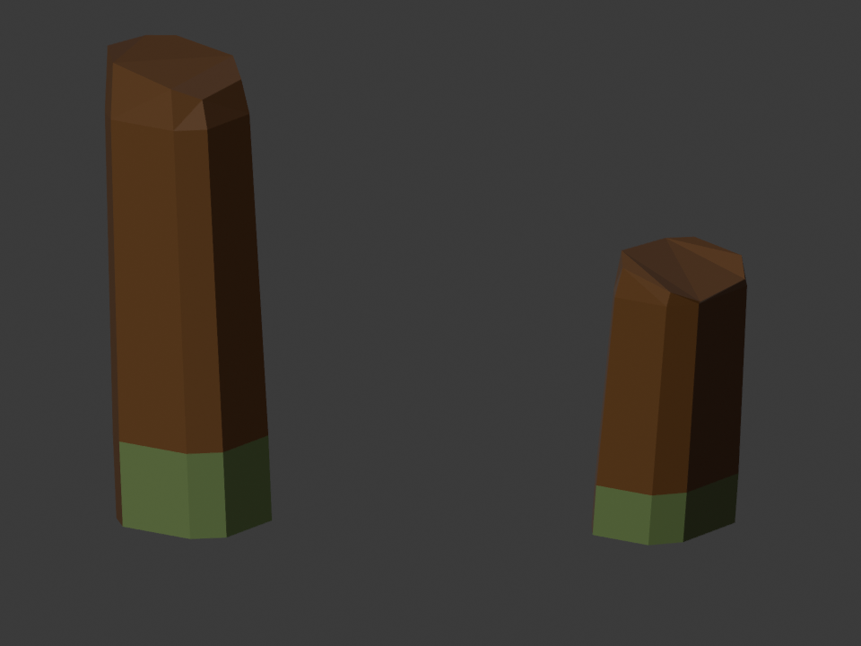

# Marshward Mooring Posts

## Brief

A settled Unreal viewport-only view from the crossing at `(0,1750,360)`,
pitch -13, yaw 9, roll 0 and FOV 90 shows open peat between the inner
south rock cluster and the near bank. Use one compact pair of weathered,
uneven-height timber posts to suggest an abandoned use for the basin edge.
Keep the posts separate: no rail, boardwalk, rope across a path, directional
marker, interaction, or change to the dry basin's support. No physical
walking or camera feedback was supplied.

Build `SM_MarshwardMooringPosts_01` as two closed, bevel-edged hewn posts
with chipped tops, one UV channel, no non-manifold edges, and no authored
collision. Target an exact 280 x 190 x 235 cm envelope with a base-center
pivot and both feet at local Z=0. Reuse existing PrototypeVillage timber
and marsh moss without edits. Keep an independent Blender scene, FBX,
metrics and preview.

Proposed actor: `Marshward_MooringPostsInnerSouth` at `(900,1750,-120)`,
yaw 0, unit scale and `NoCollision`. Visible bounds X=760..1040,
Y=1655..1845 leave at least 435 cm from the crossing's protected edge and
at least 985 cm from the inside edge of the protected east return. Require
the complete corridor check, no overlap with accepted dressing and two
unfiltered foot rays that still first-hit the original BasinCatch at Z=-120.
Retain all preceding 47 static actor properties, PlayerStart, route supports,
landmarks, lights and the basin-only wet-peat material. Review settled
crossing, return and arrival views after placement and run normal PIE.
Static views and traces cannot certify physical walking or camera feel.

## Implementation

The isolated Blender MCP build produced two closed posts, 120 triangles
total, with one UV channel and no hulls. The asymmetric caps and patchy moss bases
are part of the mesh, with no connecting rail or rope. The independent
source, FBX, metrics and preview are in
`ArtSource/Blender/Environment/MarshwardMarsh`.
The classic-FBX import assigns the existing PrototypeVillage timber and
marsh moss packages; it saves only the new mesh. The exact cross-folder
timber exception is scoped to the post and fallen-timber mesh slots.

The initialized editor placed only the proposed NoCollision actor. Stable
numeric signatures retained all preceding 47 actors, and a canonical digest
guards all 25 preceding dressing rows. The Causeway now contains 48 static
placements, 15 installed imported mesh types and 16 validated mesh packages,
including the retained original greybox marker. The basin remains the only
support beneath the two post feet. No service, path or water feature is added.

## Verification: 2026-11-18

- All 50 focused host tests passed. The exact 280 x 190 x 235 cm bounds,
  120 triangles, one UV channel, no hulls and both reused material paths
  passed fresh classic-FBX import and independent saved-package validation.
  The Causeway gate retained the full-width corridors plus 75 cm and the
  unchanged basin-only wet-peat graph. Both processes exited zero with no
  Python errors.
- The separate skeletal-material-first 31-package Fenwatch gate passed,
  including the guaranteed Prowler tonic and 53 Fab / 32 original-art
  placements. All 16 Fenwatch initialized-world suites passed after relaunch.
- The settled Causeway suite passed 579 support and 1,104 clearance rays
  and all earlier controls. Two additional unfiltered rays from the source
  foot centers first-hit the exact saved BasinCatch at Z=-120. They confirm
  existing ground at those points, not hidden contact across every vertex.
- Settled editor views from the crossing `(0,1750,360)` at pitch -13/yaw 9,
  return `(2700,1750,260)` at -10/180, and arrival `(0,-450,260)` at -5/90
  showed the separated posts below the deck edge. The return rock partly
  screens the pair from its shoulder. The pale crossing, existing waymarker
  and ruin silhouette remain distinct from arrival.
- Normal floating PIE confirmed Human Warrior level 1, XP 0/100, HP 100/100
  and mana 50/50 through synthetic Slate and stopped. Native discovery
  listed 133 tests; no full native run or C++ rebuild was needed.

Causeway was left All Saved outside PIE with no dirty packages. Its file
SHA256 is `5ee318a6b4075ca4fb21e1df5a286f9090ebf7c371c82da94f057aeb7764e95c`.
The Fenwatch map, protected save, keeper material and reused timber hash
were unchanged. Physical walking, turn recognition and camera feel remain
unverified. Evidence: `/tmp/embermere-nov18-mooring-import.log`,
`/tmp/embermere-nov18-causeway-packages.log`,
`/tmp/embermere-nov18-fenwatch-31-packages.log`,
`/tmp/embermere-nov18-mooring-placement-editor.log` and
`/tmp/embermere-nov18-mooring-final-editor.log`.
