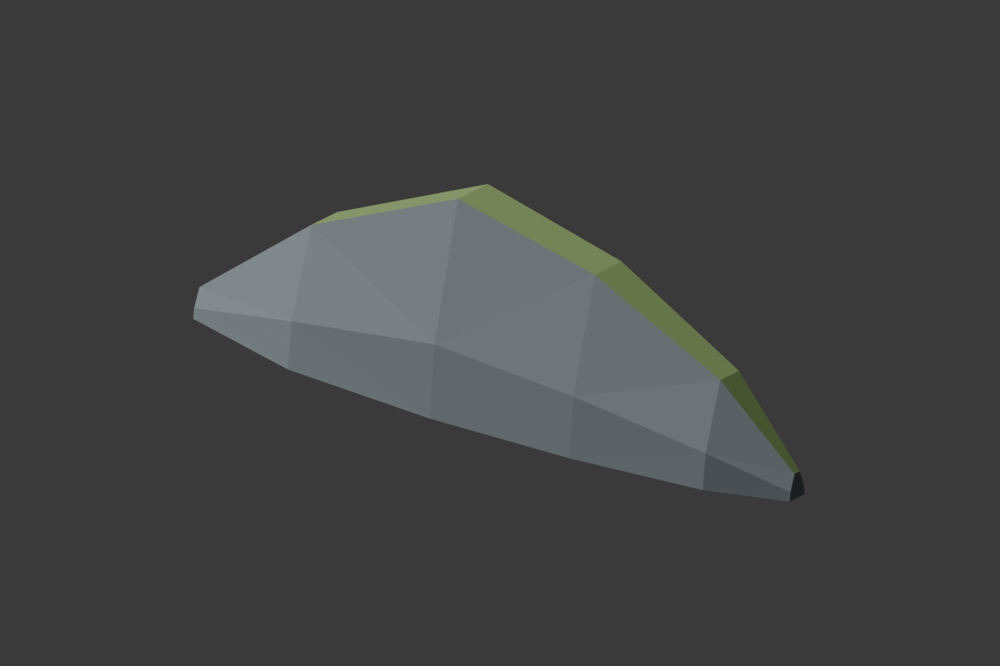

# Marshward Distant Rocky Bank

## Ownership And Brief

Fresh settled viewport-only views from(0,3300,360),pitch-5/yaw180 and
(0,1000,260),pitch-5/yaw150,roll0/FOV90 show an open western backdrop
behind the accepted low peat banks. Author one tapered faceted ridge,not
another small rock cluster or a wall enclosing the loop. Its role is distant
silhouette variation,not a finished map boundary,walkable route or hazard.
No voluntary walking/camera feedback was supplied.

`SM_MarshwardRockyBank_01`:2200x400x650 cm,base-center pivot,one closed volume,
one UV channel,zero non-manifold edges,at most100 triangles. Six cross-
sections taper both ends and vary the crest. Reuse only unchanged
`M_MarshwardMarshStone` and `M_MarshwardMoss`. One authored convex hull
provides deliberate simple blocking; no complex-as-simple collision.
Keep independent Blender scene/source,FBX,metrics and preview. Do not
rebuild accepted art or resave existing mesh/material packages.

Propose only `Marshward_RockyBankWest` at(-3850,3300,-120),yaw90,unit scale,
tagged EmbermereMarshwardMarsh,in MarshwardGreybox/MarshTerrain,BlockAll.
Visible bounds areX-4050..-3650/Y2200..4400. The basin begins atX-4100,
leaving50 cm of underlying ground beyond the outer edge; this is not an
invitation to walk off-route. The nearest accepted west shelf AABB ends
nearX-3558,leaving about92 cm between them. No other actor may move.
Preserve all45 preceding actor properties,PlayerStart,route supports,
full-width corridors+75 cm,landmarks,lights and basin-only wet peat.
Do not close either end of the walking loop or introduce a one-way trap.

## Gates

Require measured source topology/UV/bounds/pivot/hull and source preview;
fresh classic-FBX import with two reused material paths; independent saved
mesh/map validation and full-buffer exclusion. Stable numeric signatures
must agree twice before spawning and again before saving only the map.
Add positive ridge hits at three crest stations and unfiltered adjacent
basin supports on both sides atZ-120. Adjacent samples prove nearby footing,
not hidden underside contact. Preserve every existing Causeway guard.
Inspect the western approach,arrival/ruin vistas and return after placement;
run clean normal PIE. Native rays and static views do not certify physical
camera room,walking,first-visit wayfinding or a finished perimeter.

## Verification: 2026-11-16

Blender MCP built the independent68-triangle ridge at2200x400x650 cm,one
UV,zero non-manifold edges and one authored convex hull. The existing stone
and moss materials were reused unchanged. Source,FBX,metrics and preview
remain independent of accepted art. Fresh classic-FBX import passed exact
dimensions,triangles,UV,hull and reused material paths,true exit zero with
no Python errors. No existing mesh or material package was resaved.

Only one BlockAll western ridge was saved. Stable numeric signatures checked
twice before spawn and again before save retained all preceding45 actors.
Causeway is now46 static placements,13 installed imported mesh types and14
validated mesh packages including the unused original greybox marker.
Original22 roles and all walking supports,buffers,PlayerStart,lights,
landmarks and basin-only wet peat remain intact. Four new host regressions
bring focused coverage to42 tests; the previous23 placement rows are also
protected by an exact canonical digest,not only a count assertion.

Fresh independent saved-package validation passed the14-package/46-actor
Causeway contract,full-width exclusion,base-origin/simple-hull policy and
unchanged wet-peat ownership,true exit zero/no Python or material errors.
An earlier package launch did not have explicit proof that the previous
editor process was fully down; it is not counted. The accepted identical
repeat followed explicit process-down and free-port checks.
Fenwatch's independent skeletal-material-first31-package gate passed exact
skeletal,placed-Prowler loot,53 Fab/32 original-art and validators=31 markers,
true exit zero/no Python errors. Causeway counts stay separate.

The clean final editor passed all16 Fenwatch initialized-world suites and
the complete Causeway579 support/1104 clearance suite with every earlier
control,plus three exact crest hits and six adjacent basin supports atZ-120.
New queries ignore no actors. Nearby footing is not hidden underside-contact
proof. Fresh native discovery lists133,not another full native run;
November9's133/133 remains authoritative. No C++ rebuild was needed.

Settled western approach(0,1000,260),pitch-5/yaw150;arrival(0,-450,260),
pitch-5/yaw90;ruin front(0,5700,360),pitch-5/yaw90;and eastern return
(2700,3600,260),pitch-5/yaw90 were inspected atroll0/FOV90. The ridge remains
behind the nearer banks and separate from the pale route/ruin silhouette.
A preceding west-facing placement view at(0,3300,360),pitch-5/yaw180 also
showed the intended low backdrop. These are editor stills,not moving-camera
or physical walking acceptance. Normal1280x754 floating PIE used synthetic
Slate confirmation to reach Human Warrior Level1 XP0/100 HP100/100 Mana50/50
and Journey begun,then stopped cleanly. No Chronicle action was used.

Final Causeway is All Saved outside PIE on real MCP8123,dirty[],no Python
errors. Fenwatch and protected save/keeper hashes remain exact. Causeway
SHA256 is`4091ba130b6d93ad4a520c1383764abd3477e17f761d4a4091bf00bc25dcf3ce`.
Physical walking,camera room and first-visit turn recognition remain open.
Logs: `/tmp/embermere-nov16-rocky-bank-import.log`,
`/tmp/embermere-nov16-fenwatch-31-packages.log`,
`/tmp/embermere-nov16-causeway-packages.log`,
`/tmp/embermere-nov16-rocky-bank-placement-editor.log` and
`/tmp/embermere-nov16-rocky-bank-final-editor.log`.
