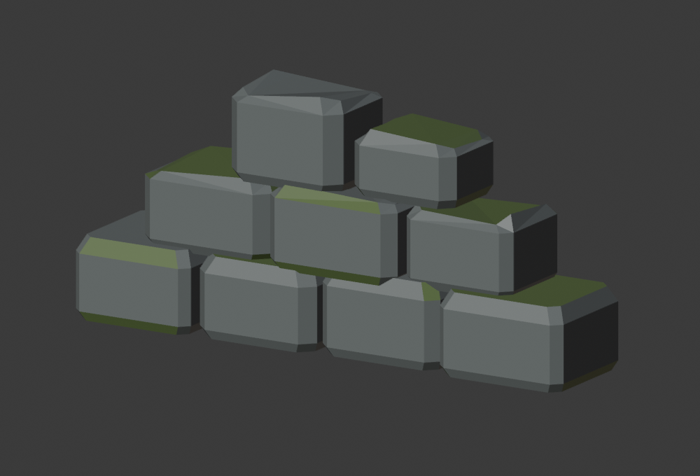

# Marshward Ruin Wall Fragment

## Brief

Settled viewport-only checks covered arrival at X=0 and X=+/-500 (Y=-450,
Z=260), north crossing approach `(0,4700,360)`, ruin back edge
`(800,6940,370)`, east ramp `(1100,6400,360)` and upper return
`(2700,5850,260)`. The northeast basin leaves room for detached masonry
without filling the main opening or encroaching on the east descent.

Build one independent `SM_MarshwardRuinWall_01` with staggered chamfered
courses, an irregular skyline and restrained moss. Target 900 x 220 x
420 cm; reuse the existing marsh stone and moss materials. Use one UV
channel and three inset simple convex cores, one per course. Face chips
and projecting edges should not create additional collision. The wall is
a freestanding ruin fragment, not a gate, ramp, trail to another zone,
or a replacement for existing ruin pieces.

Propose exactly one BlockAll `Marshward_RuinWallNortheast` at
`(1900,7600,-120)`, yaw 0, unit scale. The visible bounds X=1450..2350,
Y=7490..7710 remain east of the north berm, north of the island's rear
edge and away from the pillars, foundations and full route buffers.
The existing basin is the footing. Test the three collider courses and
unfiltered basin supports on both sides, retain all prior 50 actor
properties and inspect the same sightlines again before accepting.

## Source And Import

Nine closed chamfered stones in three offset courses share one
540-triangle mesh. The narrow tips and chipped top are visual; each
course has a smaller hand-authored convex core. Source vertical rays
verify the visible crest is above each intended collision sample. Classic
FBX retained all three simple hulls, one UV channel, exact bounds and the
two reused material paths. The independent Blender source, FBX, metrics
and preview live with the Marshward marsh kit.

## Placement And Evidence

Only the proposed BlockAll wall was installed. The editor verified that all
50 prior actor signatures were unchanged, and a digest guards the 28 prior
dressing rows. Causeway now has 51 static placements, 18 installed imported
mesh types and 19 validated mesh packages including the retained greybox
marker. The wall is 90 cm north of the island's rear edge and remains beyond
all full-width walking buffers plus 75 cm.

- All 62 focused host tests passed, covering placement, the projected gap
  to the east pillar, the inset cores and a negative ramp-buffer control.
  Fresh import and independent saved-map checks passed with exact markers,
  real exit zero and no Python errors. Basin-only wet peat and both reused
  material packages were unchanged.
- Fenwatch's separate 31-package aggregate and all 16 initialized-world
  suites passed. Causeway passed 579 support and 1,104 clearance rays and
  all earlier controls. The wall added three exact convex crest hits at
  world Z=2, 124 and 213, six nearby basin first hits at Z=-120, and two
  clear horizontal rays above the low ends. No new ray ignores an actor.
- Settled arrival at center and both offsets retained the pillars, broken
  opening and pale deck. The new stone stays low outside the opening.
  Approach, back-edge and return views show it as a separate fragment;
  from the ramp it sits at the edge of the view, not across the descent.
  An incomplete center camera-jump frame was rejected and recaptured.
- Normal floating PIE reached the Human Warrior HUD through synthetic
  Slate and stopped. Native discovery listed 133 tests; no full native
  rerun or C++ build. Physical walking, wayfinding and camera feel remain
  open.

Causeway was left All Saved outside PIE with no dirty packages. Map
SHA256: `b3d5f613fa4fefe86740800ea4ff624b8c33c325cc73f2c42d074ad231bf36b0`.
The Fenwatch map, protected save and keeper material were unchanged.
Logs: `/tmp/embermere-nov21-ruin-wall-import.log`,
`/tmp/embermere-nov21-fenwatch-31-packages.log`,
`/tmp/embermere-nov21-causeway-packages.log`,
`/tmp/embermere-nov21-ruin-wall-placement-editor.log` and
`/tmp/embermere-nov21-ruin-wall-final-editor.log`.
