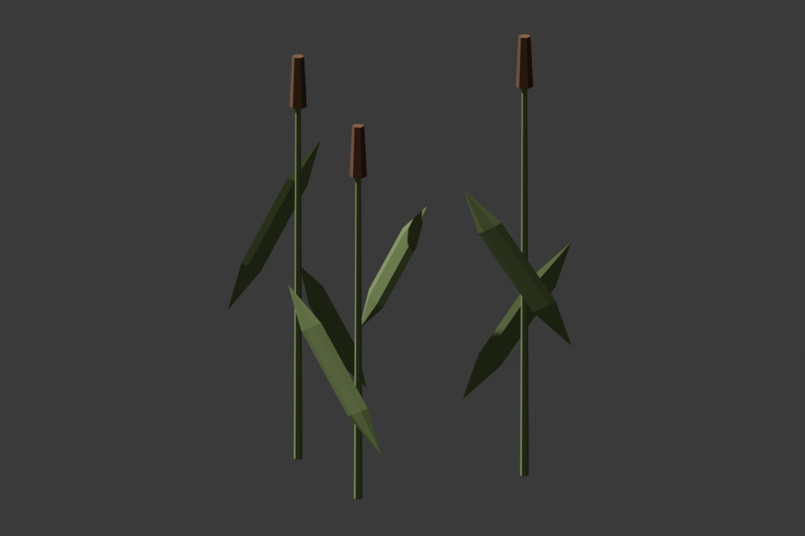

# Marshward Tall Reeds

## Ownership And Brief

Settled normal-height views from (2700,1700,260), pitch -8/yaw0, and
(2700,4900,260), pitch -8/yaw20, show the two eastern reed roles using
the same compact seven-stem silhouette. Author one taller, sparser variant
and replace only those two mesh references. Keep the return marker and
walking loop intact; this is silhouette variation, not increased density.

`SM_MarshwardTallReeds_01` is 220 x 180 x 300 cm, base-center pivot,
three closed stems/seed heads and six closed leaves, one UV channel,
zero non-manifold edges and zero authored collision. Target 264 triangles,
compared with the original seven-stem, 616-triangle, 260 x 220 x 210 cm
clump. Reuse only `M_MarshwardReedGreen` and `M_MarshwardReedSeed` without
editing either material. Keep independent Blender scene/source, FBX, metrics
and preview. Do not reauthor or resave the original clump or its materials.

Replace only `Marshward_ReedsEastNear` at (3550,1700,-120), yaw0, and
`Marshward_ReedsEastFar` at (3550,5200,-120), yaw20, both unit scale and
NoCollision. Preserve all actor transforms, profiles, tags, folders and
other mesh references. The two replacements and six original clumps still
total eight reed actors. Causeway remains 44 static placements, with eleven
kit meshes. The rotated far-clump minimum X is about 3415.9 cm, beyond the
eastern protected corridor edge at 3375. Basin-only wet peat, walking support,
PlayerStart, lights, arrival guard, masonry, foundations and full-width
corridors plus 75 cm stay fixed. No C++, gameplay, water, travel or save changes.

## Gates

Inspect source topology/dimensions/UVs/preview and require fresh classic-FBX
import with exact reused materials and no hulls. The replacement helper must
verify every preceding actor property, allowing only two intended mesh-path
changes. Require a separate fresh saved-map gate with actual visible bounds
for all rotated dressing. Preserve all existing live suites; add six
unfiltered stem-base-to-basin probes at Z=-120 across the two clumps. They
prove existing ground and lack of collision at those probes, not visual
occlusion or new support. Inspect both eastern views and arrival/landmark
views after settling the actual camera. Native rays cannot certify
NoCollision art readability; physical two-direction walking/camera gates
remain open. No voluntary physical playtest state was supplied.

## Verification: 2026-11-11

Blender MCP built the 220 x 180 x 300 cm, 264-triangle variant with one UV,
zero non-manifold edges, three stems, six leaves and no hulls. The source
preview was inspected and framed with breathing room. Both existing reed
materials and the original clump/source stayed unchanged. Twenty-seven
focused host checks passed: 16 corridor, five foundation, three masonry and
three tall-reed checks. The smaller rotated footprint remains outside the
fixed full-width corridor plus 75 cm; no count or buffer was relaxed.

Fresh GUI-down classic-FBX import passed exact size/triangle/UV/zero-hull/
material checks, true exit zero, no Python errors. The initialized helper
used the existing numeric preservation signature to permit only the two
mesh-path changes, verifying every other actor property before saving the
map. A separate fresh package gate passed **eleven kit meshes / 44 static
placements**, full buffers and unchanged basin-only wet peat, true exit zero,
no Python/material errors. Fenwatch's independent skeletal-material-first
31-package gate retained exact Prowler, 53 Fab/32 original-art and validators=31
markers, true exit zero, no Python errors.

The final clean session passed all **16 Fenwatch suites**, Causeway's **579
support / 1104 clearance** rays and every prior marker/bank/rock/apron/
foundation/masonry/arrival control, plus **six unfiltered reed-base-to-basin
supports**. Both replacement components remain NoCollision. These rays
prove existing ground and collision policy, not the visibility of leaves.

Settled eastern near/far views at the briefed poses showed the taller sparse
silhouette separate from the marker. Three arrival views at X=0,-500,+500,
Y=-450,Z=260,pitch -5/yaw90 retained the crossing and pillar/lintel silhouette.
Roll0/FOV90 throughout. No new actor, light, route or camera setting was saved.
Normal 1280x754 floating PIE used the picker, confirmed Human Warrior
HP100/100/Mana50/50 through Unreal-owned Slate, and stopped cleanly. No
physical input, painted player-camera or walking acceptance is claimed.

Causeway is All Saved outside PIE on real MCP8123, dirty [], with no Python
errors in the final session. Fresh discovery lists 133, not another native
run; November 9's 133/133 full run remains authoritative. No C++ rebuild was
needed. Fenwatch and protected save/keeper hashes stayed exact. Causeway hash:
`17994a6c2e011c30b57198aca9d293191c057f009163f8f8e7ce3eed00a4e8ed`.

Logs: `/tmp/embermere-nov11-tall-reeds-import.log`,
`/tmp/embermere-nov11-fenwatch-31-packages.log`,
`/tmp/embermere-nov11-causeway-packages.log`,
`/tmp/embermere-nov11-tall-reeds-replacement-editor.log`, and
`/tmp/embermere-nov11-tall-reeds-final-editor.log`.
