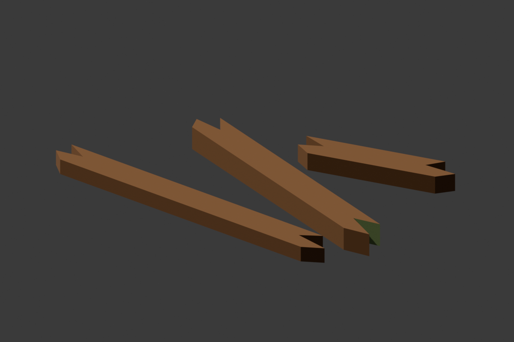

# Marshward Fallen Timber

## Ownership And Brief

A fresh settled viewport-only shoulder view from(0,3300,360),pitch-12/yaw0,
roll0/FOV90 shows the basin gap between the two inner peat banks. Author
one compact scatter of three short fractured timbers in that gap,not a
boardwalk extension or replacement for the accepted stone spans. Separate,
staggered pieces must not suggest another walking route. No voluntary
physical traversal feedback was supplied.

`SM_MarshwardTimberDebris_01`:380x260x30 cm,base-center pivot,three closed
broken-end prisms,one UV channel,zero non-manifold edges,at most100 triangles,
zero authored collision. Each piece has a flat base atlocalZ0. Reuse unchanged
`M_EmbermereTimber` from PrototypeVillage and `M_MarshwardMoss` from the marsh
kit. No new material,wet-peat assignment,physics or support authority.
Retain independent source scene,FBX,metrics and preview before adoption.

Propose only NoCollision `Marshward_TimberDebrisInner` at(1200,3300,-120),
yaw0,unit scale,tagged EmbermereMarshwardMarsh,in the existing terrain folder.
BoundsX1010..1390/Y3170..3430 leave at least685 cm from the protected raised
crossing edgeX325 and635 cm from the return's protected inner edgeX2025.
Existing inner-bank AABBs end nearY2825 and begin nearY3775,leaving340 cm
or more from this scatter. No fragment may extend onto the playable deck.
Preserve all46 preceding actors/properties,original22 roles,full corridor
widths+75 cm,PlayerStart,route supports,lights,landmarks and basin-only wet
peat. The basin remains solid dry catch ground,not water or a new hazard.

## Gates

Require source dimensions,pivot,topology,one UV,three distinct closed pieces,
no hulls and a source preview. Fresh classic-FBX import must reuse the exact
saved timber/moss paths and save only the new mesh. Independent saved-package
checks must retain old mesh/material contracts and every protected corridor.
Stable numeric signatures must agree twice before spawning and again before
saving only the map. Add three unfiltered fragment-base rays that first-hit
the original basin atZ-120,with the actor still NoCollision. These prove
original support policy,not visual grounding at every vertex or hidden contact.
Inspect deck-side,return-side and arrival views and run clean normal PIE.
Static views/native rays do not prove physical movement or moving-camera feel.

## Verification: 2026-11-17

Blender MCP built an independent84-triangle source with three separate closed
pieces,one UV,zero non-manifold edges,base-center pivot and no hulls. All
bases are localZ0; dimensions are380x260x30 cm. Source,FBX,metrics and preview
are retained independently. Fresh classic-FBX import reused exact saved
PrototypeVillage timber and marsh moss paths,with no existing asset/material
resave. The process exited zero with the exact import marker and no Python
errors. Timber material SHA256 remained
`c78f2e0f71070b9a850828851f53518a23b9f1b0ed212f3e84f69b4e3499ae18`.

Only one NoCollision actor was saved. Stable numeric signatures checked
twice before spawn and again before save retained every preceding46 actor
property. Four new host regressions bring focused coverage to46 tests;
the canonical prior24 placement rows retain digest
`7b765b46c28ee14c813435ead466feb52f631a8224f9a8db3002e8e99a40d2b0`.
The older prior23-row rocky-bank preservation guard remains intact.
Causeway is now47 static placements,14 installed imported mesh types and15
validated mesh packages including the unused original greybox marker.
The original22 roles,support geometry,full-width buffers,PlayerStart,
lights,landmarks and basin-only wet peat remain unchanged.

Fresh independent Causeway package validation passed exact mesh dimensions,
84tri,one UV,zero hulls,base-origin/material paths,47 placements,full-width
exclusion and unchanged wet-peat graph/ownership,true exit zero/no Python or
material errors. Fenwatch's separate skeletal-material-first31-package gate
passed exact skeletal,guaranteed Prowler tonic,53 Fab/32 original-art and
validators=31 markers,true exit zero/no Python errors. Every commandlet
launch followed explicit process-down and free-port checks; no marker-only
or hung run was counted. No C++ build was needed.

The clean final editor passed all16 Fenwatch initialized-world suites,then
the separately loaded/settled complete Causeway579 support/1104 clearance
suite with every earlier guard,including rocky bank and return shoulders.
Three new unfiltered fragment-base rays first-hit the exact original basin
atZ-120 while the debris remained NoCollision. They prove original support
policy,not every visual vertex or physical contact. No new query ignores
actors. Only the older rock-cluster underlying-ground diagnostics ignore
their own cluster. Fresh native discovery lists133,not another full native
run; November9's133/133 evidence remains authoritative.

Settled viewport-only deck side(0,3300,360),pitch-12/yaw0;return side
(2700,3300,260),pitch-10/yaw180;and arrival(0,-450,260),pitch-5/yaw90 were
inspected atroll0/FOV90. The short separated pieces remain on the basin floor
between banks,away from both routes; no plank connects walking surfaces.
Arrival retains the pale crossing and forward ruin silhouette. These static
observations are not uncoached wayfinding or moving-camera acceptance.
Normal1280x754 floating PIE used synthetic Slate confirmation to reach Human
Warrior Level1 XP0/100 HP100/100 Mana50/50 and Journey begun,then stopped.
No Chronicle action or forced combat/quest/service state was used.

Final Causeway is All Saved outside PIE on real MCP8123,dirty[],no Python
errors. Fenwatch and protected save/keeper hashes stay exact. Causeway SHA256:
`8d0bb12ce64b289610d58d59bdbf1bc11907a967c006468736232a742f845092`.
Physical walking,camera room and first-visit turn recognition remain open.
Logs: `/tmp/embermere-nov17-timber-import.log`,
`/tmp/embermere-nov17-fenwatch-31-packages.log`,
`/tmp/embermere-nov17-causeway-packages.log`,
`/tmp/embermere-nov17-timber-placement-editor.log` and
`/tmp/embermere-nov17-timber-final-editor.log`.
