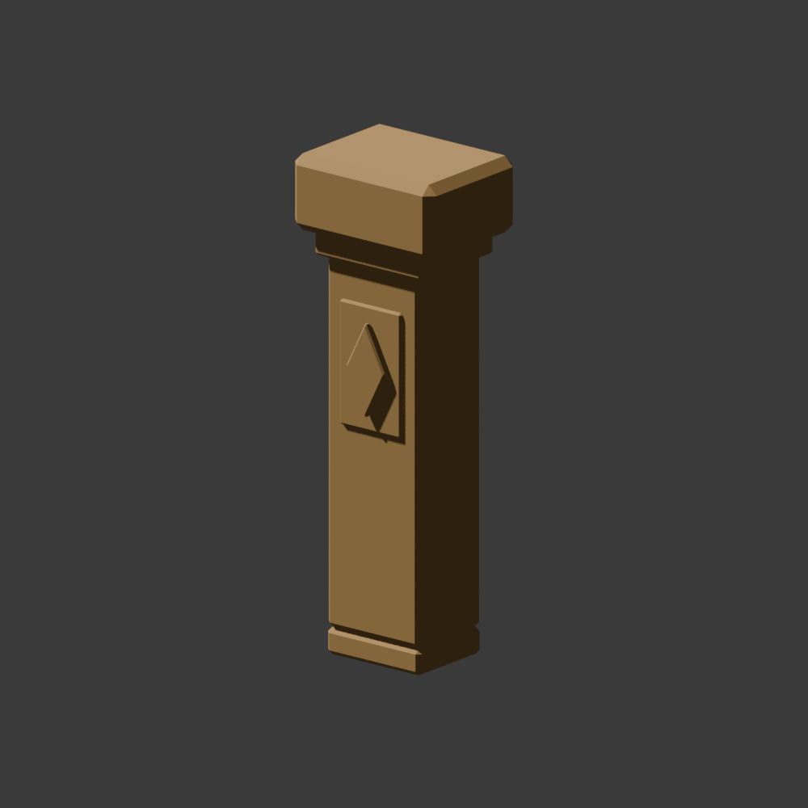

# Marshward Carved Waymarker

## Ownership And Brief

Fresh settled viewport-only arrival (0,-450,260),pitch-5/yaw90 and return
(2700,4500,260),pitch-3/yaw70 views show the three existing warm blockout
markers, their plain cap/body and small inset. Build one original chamfered
stone variant with a shallow paired-face diamond relief, not another marker
or a new navigation instruction. Retain the existing warm material and
landmark silhouette. No voluntary physical walk/camera feedback was supplied.

`SM_MarshwardWaymarker_01`:180x140x520 cm, bounds(-90,-70,0) to(90,70,520),
base-center pivot, one UV, zero non-manifold edges, at most400 triangles.
Chamfer the stone body, foot, collar and cap; relief panels on both broad
faces remain purely decorative. Reuse only `M_MarshwardGreyboxMarker`, with
no material edit. Retain independent Blender scene/source, FBX, metrics and
preview under `ArtSource/Blender/Environment/MarshwardWaymarker`.

## Parity And Adoption

Keep one exact UBX body box:120x100x440 cm,center(0,0,220),source rotation zero.
This matches the accepted greybox marker, whose cap/inset have no collision.
Fresh persisted checks must compare both actual saved bounds and all box
dimensions/center/rotation, reject other shapes and retain original mesh/
material/source bytes. Decorative chamfers may not enlarge collision.
Classic FBX reports approximately -180 yaw for both saved boxes; compare
the actual imported rotations modulo360, not an assumed Python zero.

Replace only mesh references on ArrivalMarker(-750,650,0),yaw0;
RuinMarker(-950,6400,120),yaw0; ReturnMarker(3000,5300,0),yaw90.
Use the original layout manifest unchanged. Preserve all45 actors, numeric
transforms, folders, tags, profiles and material paths. Only these three mesh
paths may differ. Keep original greybox asset validation; deliberately map
only its three existing Waymarker roles to the separately validated variant.
There remain45 static placements,12 installed imported mesh types,plus the
retained unused original marker:13 validated kit packages. Do not count Cube.

Original route support, PlayerStart, terrain/art placement buffers, lighting,
arrival landmark guard and basin-only wet peat remain fixed. Existing
markers are grandfathered shoulder landmarks, not newly exempted dressing.
No C++, combat, quest, service, interaction, water, travel or save changes.

## Gates

Require source topology/UV/pivot/bounds/box metrics and preview; fresh classic-
FBX import; independent package parity and saved-map checks; stable numeric
signatures twice before replacement and all expected signatures before save.
Reject enlarged bounds, shifted/rotated boxes or wrong material/role paths.
Retain the full Causeway route and all earlier dressing/arrival controls.
Add six positive body entry rays (local X/Y) and six decorative-clear rays
(cap overhang/front relief) across all three rotated placements, ignoring
no actors. Inspect settled arrival offsets and return/ruin approaches; run
normal picker/PIE. Rays and editor stills do not prove physical camera feel,
readability while moving or first-visit wayfinding. Keep those gates open.

## Verification: 2026-11-13

Blender MCP built the independent 352-triangle marker at the exact briefed
bounds,base pivot,one UV and zero non-manifold edges. Preview refinement
separated a coplanar foot/body seam and chamfered the relief before import.
The single warm material,original greybox mesh/source and every previous
art asset remain unchanged. Source,FBX,preview and metrics are retained.

All34 focused host checks passed,including rejection of expanded/shifted
visible bounds and body boxes. Fresh classic-FBX import passed exact saved
bounds,one body box including actual center/rotation,UV/material and shape-
count parity,true exit zero/no Python errors. Four separate isolated engine
controls rejected an enlarged box,shifted center,changed rotation and wrong
material. They restored all transient edits and saved nothing; their fresh
process exited zero without Python errors.

The initialized replacement helper checked stable numeric signatures twice
before mutation,permitted exactly three mesh paths and verified every other
actor property before saving only the map. Fresh complete Causeway package
validation passed13 validated mesh packages,12 installed imported mesh types
and45 static placements,unchanged full buffers and basin-only wet peat,
true exit zero/no Python/material errors. Original greybox asset gates remain
intact; only the explicit three Waymarker role paths changed. Fenwatch's
separate skeletal-material-first31-package gate passed exact skeletal,
placed-Prowler loot,53 Fab/32 original-art and validators=31 markers,
true exit zero/no Python errors.

The clean final editor passed all16 Fenwatch live suites,complete Causeway
579 support/1104 clearance and all earlier dressing/arrival controls,plus
six exact body entry points and six decorative-clear rays at the three
rotated markers. No new query ignores actors. Settled center/offset arrival,
return and ruin views retained clear approaches and landmark separation.
Return pose is(2700,4500,260),pitch-3/yaw70; ruin pose(-350,6200,380),
pitch0/yaw155; arrival X0,-500,+500/Y-450/Z260,pitch-5/yaw90.
Roll0/FOV90 throughout. These are editor stills,not physical moving-camera proof.

Normal1280x754 floating PIE confirmed Human Warrior Level1 XP0/100,
HP100/100 Mana50/50 via Unreal-owned Slate and stopped cleanly. Discovery
lists133 native tests,not another full run; November9's133/133 remains the
authoritative full-native evidence. No C++ build was needed. Final Causeway
is All Saved outside PIE on real MCP8123,dirty[],with no Python errors.
Fenwatch and protected save/keeper hashes stayed exact. Causeway SHA256:
`84b82b523129ccf31d089c57e4847e1451e7eb83aa70245c053ae134173d2edb`.

Logs: `/tmp/embermere-nov13-waymarker-import.log`,
`/tmp/embermere-nov13-waymarker-negative.log`,
`/tmp/embermere-nov13-fenwatch-31-packages.log`,
`/tmp/embermere-nov13-causeway-packages.log`,
`/tmp/embermere-nov13-waymarker-replacement-editor.log`, and
`/tmp/embermere-nov13-waymarker-final-editor.log` (exact success markers,
`WAYMARKER_FINAL_DIRTY []`,correct world).
