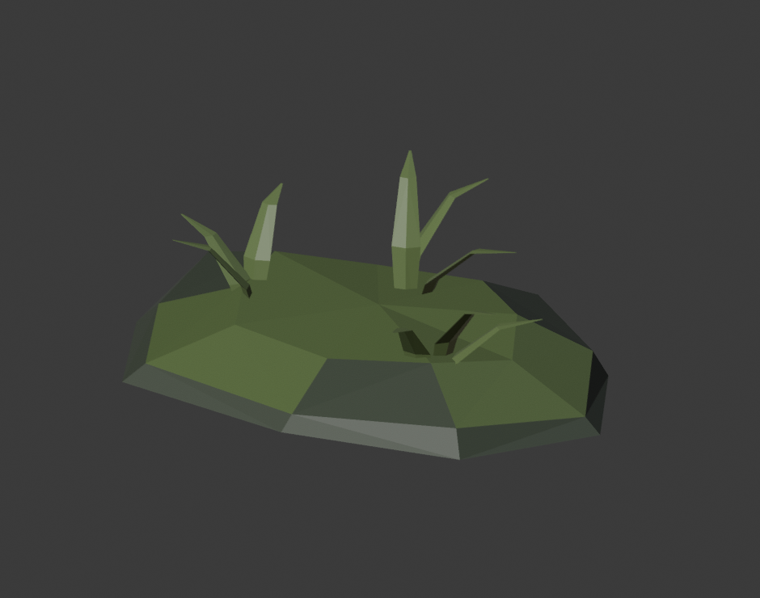

# Western Marsh Tussock

## Brief

Settled west-facing views from the crossing at `(0,2550,360)` and
`(0,4290,360)`, pitch -8 and yaw 161/-161, and a close diagnostic view
from `(-1580,3290,160)`, pitch -8/yaw 175, frame an open patch of peat on
the crossing side of the western dead tree. Use one sparse, low sedge
tussock to break up that bare ground. It should not read as another reed
stand, a trail of props, an exposed tree root or an interaction target.

Build `SM_MarshwardWestTussock_01` in isolated Blender: an uneven,
flat-bottomed peat cushion with short, tapered blades rooted into it.
Target 240 x 170 x 72 cm, one UV channel, a base-centered pivot and no
authored collision. Reuse marsh peat, moss and reed green; keep its
editable source, FBX, metrics and preview independently.

Propose one NoCollision actor `Marshward_WestTussock` at
`(-2290,3480,-120)`, yaw 0, unit scale. Its full visible bounds
X=-2410..-2170, Y=3395..3565 leave 80 cm from the tree's crown AABB and
stay between the west banks and outside every protected route buffer.
Verify under the cushion with unfiltered rays first-hitting the original
basin. Retain all 49 preceding actor properties, support, lights,
PlayerStart, markers and basin-only wet peat. Review both crossing
directions, the diagnostic close angle and the arrival vista in Unreal;
stills and traces are not physical walking or camera proof.

## Source And Import

One independent Blender scene contains a closed flat-bottomed cushion and
nine short closed blades. Source rays checked that each blade's four base
vertices are embedded in the peat and that three distinct points lie on
the cushion's flat foot. The mesh has 304 triangles, one UV channel, no
non-manifold edges and no authored collision. Classic FBX retained the
exact dimensions and reused the existing peat, moss and reed-green material
packages. No prior source, mesh or material was resaved.

## Placement And Evidence

The editor saved only the proposed tussock after checking that every
preceding actor signature stayed unchanged. A digest guards all 27 prior
dressing rows. Causeway now has 50 static placements, 17 installed
imported mesh types and 18 validated mesh packages including the retained
greybox marker. The tussock and the tree retain separate visible bounds.

- All 58 focused host tests passed, including the route-buffer boundary
  and full tree-crown separation checks. Fresh import and saved Causeway
  package validation exited zero with exact success markers, full
  corridor buffers plus 75 cm, unchanged basin-only wet peat, and no
  Python errors.
- Fenwatch's separate 31-package aggregate and all 16 initialized-world
  suites passed. Causeway passed 579 support and 1,104 clearance rays
  plus all prior controls and three new unfiltered first hits on the
  original BasinCatch at Z=-120. These sample existing ground beneath
  the cushion, not contact across every vertex.
- Both crossing angles and the close diagnostic still show the clump
  low and separate from the trunk, with the higher tree and banks still
  dominant. The center arrival still at `(0,-450,260)`, pitch -5/yaw 90,
  retains the marker face, pale crossing and ruin silhouette.
- Normal floating PIE reached the Human Warrior HUD through synthetic
  Slate, then stopped. Native discovery listed 133 tests; no full native
  rerun or C++ build. Physical walking, wayfinding and camera feel are
  still open.

Causeway was left All Saved outside PIE with no dirty packages. Map
SHA256: `5e401e50e703b323f139cacdf7a1cb318c962fb71ceacf72ddc67d9bfedbfa4c`.
The Fenwatch map, protected save, keeper material and reused materials
were unchanged. Evidence: `/tmp/embermere-nov20-west-tussock-import.log`,
`/tmp/embermere-nov20-fenwatch-31-packages.log`,
`/tmp/embermere-nov20-causeway-packages.log`,
`/tmp/embermere-nov20-west-tussock-placement-editor.log` and
`/tmp/embermere-nov20-west-tussock-final-editor.log`.
